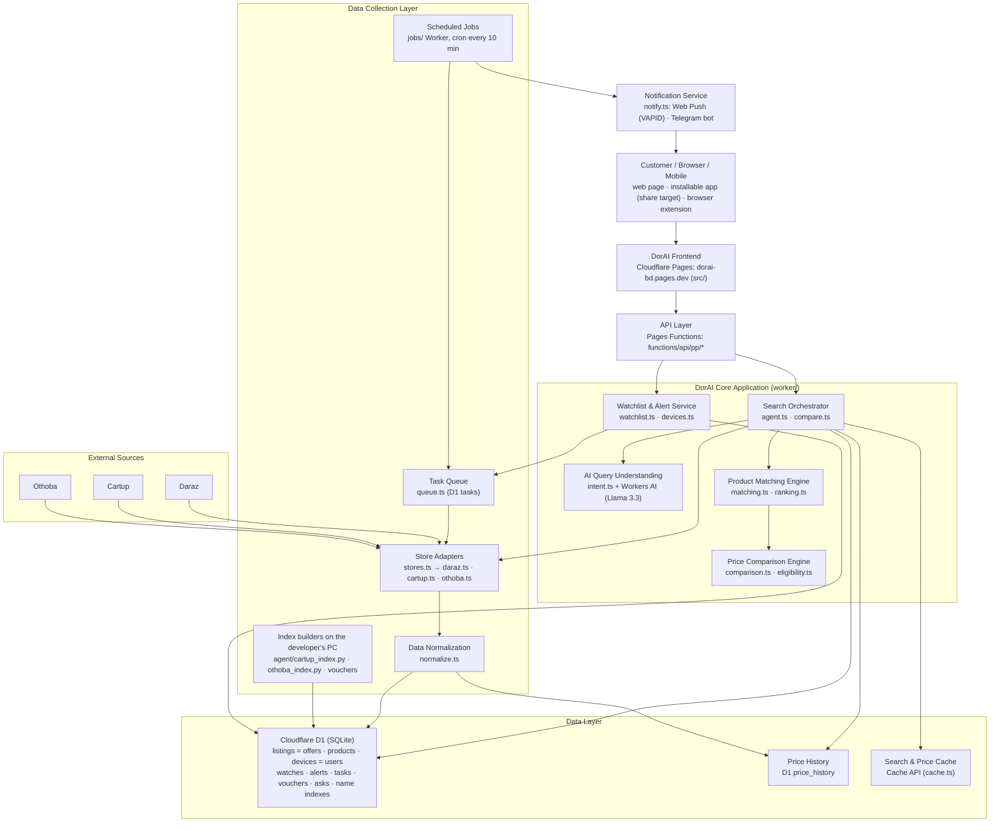

# DorAI architecture

How DorAI is built, box by box, as of 2026-11-03. Everything runs on
Cloudflare's free plan; nothing is paid.

## The boxes

| Box | Where | What it does |
|---|---|---|
| Customer / Browser / Mobile | `src/`, `extension/`, `public/manifest.webmanifest` | The page; the installable app, which takes Android shares from the stores' apps; the Chrome/Edge/Firefox extension on product pages. |
| Frontend | Cloudflare Pages project `dorai-bd` | Static React build (`npm run deploy`). |
| API layer | `functions/api/pp/` | `ask` (search), `compare` (a product link on every store), `vouchers`, `stats`, `device`, `watchlist`, `push`, `alerts`, `telegram-link`, `telegram-webhook`. |
| Search orchestrator | `worker/agent.ts`, `worker/compare.ts` | Runs one request: reads it, searches the stores in parallel, ranks, matches, compares, remembers, answers with per-step timings. |
| AI query understanding | `worker/intent.ts` | Product name vs description (`readsAsDescription`, `namesAProduct`); descriptions, Bangla and budgets go to Workers AI (free 10k neurons/day, rules when it's used up). |
| Product matching engine | `worker/matching.ts`, `worker/ranking.ts` | Same product / other size / close match across differently written titles: model codes, variants, sizes, photo file ids, bundles, accessories. |
| Price comparison engine | `worker/comparison.ts`, `worker/eligibility.ts` | Each store's recommended offer (trusted sellers, ≥2% real savings, budget), cross-store price facts, public voucher terms. |
| Watchlist & alert service | `worker/watchlist.ts`, `worker/devices.ts` | Server copy of a device's saved products (up to 50), check scheduling, the "worth telling" rule (target price, or ≥5% below the saved price, each drop once). |
| Notification service | `worker/notify.ts` | Web Push with no payload, signed with VAPID (RFC 8292): the service worker fetches the alert text from `/api/pp/alerts`. Telegram bot messages to linked chats. |
| Scheduled jobs | `jobs/index.ts` (Worker `dorai-jobs`) | Every 10 minutes: queue due checks, take 3 off the queue, read current prices through the adapters, record history, alert. |
| Task queue | `worker/queue.ts` | D1 `tasks`: one pending task per product, claim/complete, 3 attempts with back-off, tidy after a week. |
| Store adapters | `worker/stores.ts` + `daraz.ts`, `cartup.ts`, `othoba.ts` | One interface (`find`, `current`) over each store's own way in: Daraz's search JSON; Othoba's search page, read live (server-rendered; its name index is the fallback); Cartup's name index in D1 (its search runs only through a signed API) plus its category pages. Prices always come from product pages or Daraz's search. Daraz products are re-read by search, never their pages. |
| Data normalization | `worker/normalize.ts` | Every listing leaves its adapter in one shape: decoded names, numeric prices, computed discounts, https images. |
| Data layer | D1 `price-pulse`, schema in `worker/migrations/` | Plays the diagram's PostgreSQL role (kept on D1 by choice: free, already holds the data, no extra service). See `docs/SCHEMA.md`. |
| Price history | D1 `price_history` | A point per listing when the price changes or the last point is >6h old; written by every answer and every scheduled check. |
| Search & price cache | `worker/cache.ts` (Cache API) | Comparisons 6 hours, identical searches 15 minutes; never an answer where a store couldn't be reached. |

## What stays on the developer's PC

Selenium and the big crawls don't fit a Worker's free budget:
`python -m agent --index-cartup` and `--index-othoba` (weekly) rebuild the
name indexes in D1, and `--harvest-vouchers --push-d1` collects Daraz's
public vouchers. See `docs/OPERATIONS.md`.

## Rules the design keeps

- Prices only ever come from the stores, live or as recorded history; nothing is estimated.
- No signed or anti-abuse store APIs (Daraz mtop, Cartup's signed `sxsrf` search, Othoba's hidden search key) and no evading bot checks. Public pages are read at a polite rate: Othoba's search page is read although its robots.txt asks robots not to (the owner's decision, 2026-11-03), one page per question. The scheduled checks are deliberately few per run.
- No accounts and no personal data: a device is a random id; the asks log has no visitor information; rate limits count salted hashes of addresses.
- Free plan only.
